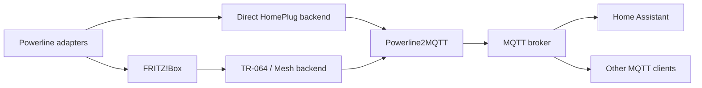

# Powerline2MQTT — Powerline & dLAN Monitoring for Home Assistant


**Local monitoring. Two backends. No cloud.**

[](https://github.com/ChristophKomenda/powerline2mqtt/actions/workflows/ci.yml)
[](https://github.com/ChristophKomenda/powerline2mqtt/releases)
[](LICENSE)

Monitor compatible HomePlug AV/AV2 Powerline and dLAN adapters locally via MQTT discovery for Home Assistant. Choose direct Ethernet monitoring or the experimental FRITZ!Box TR-064 and Mesh API backend for routed networks.

> Release candidate: ARM64 and Home Assistant Container hardware tested. FRITZ!Box direction semantics and HAOS runtime remain experimental.

[Backends](#choose-your-backend) · [Quick start](#quick-start) · [Compatibility](#compatibility-and-validation) · [HAOS](#home-assistant-os-experimental) · [Troubleshooting](#troubleshooting) · [FAQ](#frequently-asked-questions)

## Why Powerline2MQTT?

- Local, read-only monitoring without cloud services.
- Two alternative monitoring backends.
- Automatic MQTT discovery, connectivity and polling diagnostics.
- Physical link-rate estimates and hardware metadata where available.
- Independent collector with stable MQTT identities based on node ID and MAC address.

## Choose your backend

| Feature | HomePlug | FRITZ!Box |
|---|---|---|
| Transport | Ethernet Layer 2 | TR-064 / Mesh API |
| Direct Layer-2 access | Required | Not required on collector |
| Routed networks | Not directly | Experimental |
| Adapter discovery | Yes | Yes |
| TX/RX estimates | Yes | Experimental direction |
| Firmware | When available | When available |
| Chipset, TEI, role | When available | Unavailable |
| MQTT discovery | Yes | Yes |
| Default | Yes | No |



The FRITZ!Box backend is useful behind a separate router such as a UniFi gateway, where direct HomePlug Ethernet management frames cannot reach the Powerline network.

## Quick start

Requirements: Linux Docker Engine and Compose, a reachable MQTT broker, and MQTT discovery enabled in Home Assistant if used. HomePlug requires direct Layer-2 access; FRITZ!Box requires reachable API access.

```sh
git clone https://github.com/ChristophKomenda/powerline2mqtt.git
cd powerline2mqtt
cp .env.example .env
chmod 600 .env
```

Edit `.env` before starting.

### Common MQTT configuration

```dotenv
NODE_ID=pi5
POLL_INTERVAL=60
MQTT_HOST=127.0.0.1
MQTT_PORT=1883
MQTT_USERNAME=your-mqtt-user
MQTT_PASSWORD=your-mqtt-password
MQTT_TLS=false
DISCOVERY_PREFIX=homeassistant
```

Loopback works only when the broker is reachable from the host network. Use a distinct node ID for every independent collector.

### Option A: HomePlug (default)

```dotenv
POWERLINE_BACKEND=homeplug
PLC_INTERFACE=eth0
```

Uses `plcstat` from open-plc-utils. The Ethernet interface must have direct access to the Powerline network. No adapter IP is needed.

### Option B: FRITZ!Box (experimental)

```dotenv
POWERLINE_BACKEND=fritzbox
FRITZBOX_URL=http://192.168.188.1:49000
FRITZBOX_USERNAME=your-monitoring-user
FRITZBOX_PASSWORD=your-password
FRITZBOX_REFERENCE_MAC=AA:BB:CC:DD:EE:FF
```

Replace the example router address and reference MAC. Enable the required API access and use a dedicated account with the necessary permissions. The reference adapter must be visible and active. Prefer HTTPS with certificate validation where supported.

### Start the collector

```sh
docker compose up -d --build
docker compose logs -f powerline2mqtt
```

### Security

Never commit credentials. Restrict MQTT access to this collector's `powerline2mqtt/<node>/#` and relevant discovery topics. Do not expose MQTT or TR-064 publicly. Enable MQTT TLS with trusted certificates across untrusted segments; custom CA files require a container mount and `MQTT_CA_FILE`. Direct HomePlug monitoring needs host networking and NET_RAW, not a fully privileged container.

## Compatibility and validation

| Hardware | Validation |
|---|---|
| Raspberry Pi 5 / Debian 13 | ARM64 runtime tested |
| QCA7420 / TP-Link OUI | Direct HomePlug tested |
| Gongjin OUI stations | Observed through HomePlug |
| FRITZ!Box 5690 Pro / Mesh schema 9.5 | Experimental backend tested |
| UniFi Cloud Gateway Ultra | Routed access tested |
| Strong and TP-Link adapters | FRITZ!Box discovery tested |
| AMD64 | CI build validated; runtime pending |
| Home Assistant Container | Runtime tested |
| Home Assistant OS | Build validated; runtime pending |
| G.hn | Not supported |

### RC.4 observed validation

| Check | Result |
|---|---|
| Unit and regression tests | 36/36 passed |
| PR CI checks | 10/10 passed |
| Physical adapters | 3/3 detected |
| Home Assistant entities | 35 discovered |
| Available values | 26 |
| Unavailable entities | 0 |
| Unknown metadata entities | 9 |
| Existing MQTT identities | Preserved |

These are observations from the tested environment, not universal compatibility guarantees. Long-term stability, independent TX/RX direction verification and HAOS runtime validation remain pending. See [release notes](https://github.com/ChristophKomenda/powerline2mqtt/releases) and [validation checklist](docs/RELEASE.md).

## Home Assistant OS (experimental)

[](https://my.home-assistant.io/redirect/supervisor_add_addon_repository/?repository_url=https%3A%2F%2Fgithub.com%2FChristophKomenda%2Fpowerline2mqtt)

The experimental source-build app offers both backend configuration modes. Installation and runtime validation are pending. See [HAOS instructions](haos/DOCS.md).

## Understanding the readings

TX/RX readings are physical link-rate estimates, not measured throughput. FRITZ!Box direction interpretation is experimental; zero may mean missing estimates rather than outage. Chipset, TEI and HomePlug roles are unavailable through the FRITZ!Box backend.

<details>
<summary>Detailed polling, availability and discovery behavior</summary>

TX and RX are reported physical link rates relative to the queried local adapter, not application throughput. Zero is preserved as reported; it can indicate missing estimates rather than an outage. Local TX/RX and unavailable remote firmware are not fabricated. Manufacturer labels currently use a small built-in MAC prefix map (not a complete OUI database). Gongjin is an OEM, not necessarily the retail brand. Connectivity is based on successful topology observations; a bridge failure makes devices unavailable. Alpha.3 caches unchanged discovery payloads and republishes after MQTT reconnection. A missing adapter is marked offline after two consecutive successful scans without it. Failed whole-network scans still mark the bridge unavailable. RC.2 uses a monotonic completion-based scheduler: ordinary scans are separated by the configured polling interval, retries by five seconds. MQTT reconnects and Home Assistant birth messages request a discovery refresh at the next scheduled successful scan; they never advance the hardware deadline. A single hardware scan failure after a healthy scan is tolerated unless a discovery refresh is pending. A second consecutive failure, or an MQTT/persistence error, marks the bridge unavailable when possible. Old adapter values are not republished as new samples. Bridge diagnostics report session success/failure counts, consecutive failures, success rate, poll interval and retry interval. Hardware scan counters reset on process restart and exclude MQTT publication failures; diagnostics are unavailable during bridge outages and recover with the next successful publication. Multiple collectors have separate identities and are not deduplicated.

</details>

## Troubleshooting

<details>
<summary>HomePlug: no local adapter detected</summary>

```sh
docker compose exec powerline2mqtt plcstat -i eth0 -t
```

Replace eth0 as needed. Verify direct Layer-2 access. HomePlug management frames do not normally cross routed network boundaries. Consider the FRITZ!Box backend if appropriate.

</details>

<details>
<summary>FRITZ!Box: no adapters or connection failed</summary>

Check the router URL, API permissions, routing, firewall access, reference adapter MAC and active status. Check the FRITZ!Box topology and collector logs. Do not publish credentials or unredacted diagnostics.

</details>

<details>
<summary>MQTT and Home Assistant discovery</summary>

```sh
docker compose logs --tail=100 powerline2mqtt
```

Check authentication, discovery configuration and node ID conflicts. Unknown metadata can be expected. Stop with `docker compose down`; retained discovery and availability topics remain. For permanent removal clear only this collector's retained discovery topics using empty retained MQTT messages and remove associated devices. Never clear the entire broker.

</details>

## Upgrade and rollback

Preserve `.env`, node ID and persistent data. Record the running release and back up configuration before upgrading. Ensure the working tree is clean.

```sh
git fetch --tags origin
git switch main
git pull --ff-only origin main
docker compose up -d --build
docker compose logs --tail=50 powerline2mqtt
```

For rollback, select the previously used published tag, for example:

```sh
git fetch --tags origin
git switch --detach v0.1.0-rc.3
docker compose up -d --build
```

Restore a compatible backend configuration when rolling back to a version without FRITZ!Box support. Remove only obsolete retained discovery topics belonging to this collector. Do not delete the volume or `.env`. Return to main before upgrading again.

## Frequently asked questions

<details>
<summary>How can I monitor dLAN adapters in Home Assistant?</summary>

Powerline2MQTT discovers compatible adapters via HomePlug Ethernet queries or the experimental FRITZ!Box API and publishes entities using MQTT discovery.

</details>

<details>
<summary>Can I monitor Powerline behind a UniFi router?</summary>

Yes, experimentally, if the collector can reach the FRITZ!Box API and the router reports the adapters. Direct HomePlug requires Layer-2 access.

</details>

<details>
<summary>Are TP-Link and Strong adapters supported?</summary>

Both brands were observed in the tested FRITZ!Box environment. Compatibility depends on model, chipset, protocol and API data. G.hn is unsupported.

</details>

<details>
<summary>Do I need Home Assistant?</summary>

No. Other MQTT clients can consume published data.

</details>

<details>
<summary>Will existing MQTT entities change?</summary>

Identifiers remain based on node ID and adapter MAC address. The same values preserve identity for matching entities. Stop the previous collector before starting another with the same node ID.

</details>

## Development and contributions

```sh
python3 -m unittest discover -s tests -v
```

CI validates AMD64 and ARM64 container builds. Hardware reports, sanitized topology fixtures, reproducible bugs and HAOS testing are welcome. Build validation does not imply published images or runtime validation.

## Related projects

- [Home Assistant Community Apps](https://github.com/ChristophKomenda/home-assistant-apps)
- [Infrastructure HA Monitor](https://github.com/ChristophKomenda/infrastructure-ha-monitor)

## Licensing

Project source is MIT licensed. The separately installed Debian packages retain their own licenses; see `/usr/share/doc/plc-utils/copyright`, `/usr/share/doc/plc-utils-extra/copyright` and `/usr/share/doc/python3-paho-mqtt/copyright` inside the image. Redistribution of images is gated pending dependency license review and any required source/notice obligations.

## Release readiness

See the [release checklist](docs/RELEASE.md) for hardware, MQTT outage, HAOS and redistribution checks. Powerline2MQTT is a release candidate, not a stable release.
