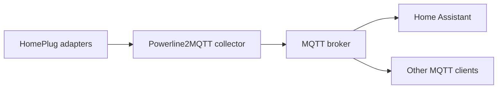

# Powerline2MQTT — dLAN and Powerline Monitoring for Home Assistant


**Local Powerline monitoring. No cloud. MQTT discovery for Home Assistant.**

[](https://github.com/ChristophKomenda/powerline2mqtt/actions/workflows/ci.yml)

Powerline2MQTT bridges compatible HomePlug AV/AV2 adapters to MQTT using Linux Ethernet management frames and `plcstat` from open-plc-utils. No adapter IP address is required. The collector can run separately from Home Assistant.

> **Experimental release candidate:** one Raspberry Pi 5 / Debian 13 / QCA7420 local adapter and two remote Gongjin-OUI stations were validated end to end with alpha.1 (18 sensors). RC.1 also ran on the same ARM64 host (14 unit tests passed, three adapters detected, one transient scan failure recovered automatically). RC.2 improves scheduling and diagnostics; its runtime validation is pending. Experimental HAOS packaging is included; other chipsets, AMD64 and HAOS are not yet validated. G.hn is not supported.

## At a glance

| Feature | Status |
|---|---|
| Raspberry Pi 5 / ARM64 | Alpha.1 hardware validated |
| MQTT discovery | Alpha.1 validated: 18 sensors |
| QCA7420 (TP-Link OUI) | Local adapter validated |
| Gongjin OUI | Two remote stations observed |
| Other chipsets / AMD64 / HAOS | Not hardware validated |

[Quick start](#quick-start) · [HAOS](#home-assistant-os-experimental) · [Upgrade and rollback](#upgrade-and-rollback) · [Readings](#understanding-the-readings) · [Troubleshooting](#troubleshooting) · [Contributing](#development-and-compatibility)

## What you get

- Automatic topology discovery, TX/RX link rates, network role and TEI.
- Chipset and firmware when provided by the adapter.
- MQTT discovery, adapter connectivity and bridge diagnostics.
- Read-only management queries; no reset, pairing or firmware commands.
- Docker host networking with `NET_RAW` only (not privileged).



## Quick start

Requirements: Linux Docker Engine and Compose, an Ethernet interface connected to a compatible Powerline network, an MQTT broker, and MQTT discovery enabled in Home Assistant.

```sh
git clone https://github.com/ChristophKomenda/powerline2mqtt.git
cd powerline2mqtt
cp .env.example .env
chmod 600 .env
# Edit .env for your broker and Ethernet interface
docker compose up -d --build
docker compose logs -f powerline2mqtt
```

Set `MQTT_HOST`, `MQTT_PORT`, `MQTT_USERNAME`, `MQTT_PASSWORD`, `PLC_INTERFACE`, `NODE_ID` and `POLL_INTERVAL` in `.env`. Loopback works only when the broker is reachable from the host. Use a distinct node ID for every collector. For TLS, enable `MQTT_TLS` and use a trusted certificate; custom CA files require a container mount and `MQTT_CA_FILE` in `.env`. Never commit credentials. Limit the MQTT account to its own `powerline2mqtt/<node>/#` and relevant Home Assistant discovery topics. Do not expose the broker publicly.

## Home Assistant OS (experimental)

[](https://my.home-assistant.io/redirect/supervisor_add_addon_repository/?repository_url=https%3A%2F%2Fgithub.com%2FChristophKomenda%2Fpowerline2mqtt)

This source-build app is experimental; installation and runtime on HAOS are not yet validated. Configure the reachable MQTT broker and the correct physical Ethernet interface. See [HAOS instructions](haos/DOCS.md). Keep a distinct node ID when running multiple collectors.

## Understanding the readings

TX and RX are reported physical link rates relative to the queried local adapter, not application throughput. Zero is preserved as reported; it can indicate missing estimates rather than an outage. Local TX/RX and unavailable remote firmware are not fabricated. Manufacturer labels currently use a small built-in MAC prefix map (not a complete OUI database). Gongjin is an OEM, not necessarily the retail brand. Connectivity is based on successful topology observations; a bridge failure makes devices unavailable. Alpha.3 caches unchanged discovery payloads and republishes after MQTT reconnection. A missing adapter is marked offline after two consecutive successful scans without it. Failed whole-network scans still mark the bridge unavailable. RC.2 uses a monotonic completion-based scheduler: ordinary scans are separated by the configured polling interval, retries by five seconds. MQTT reconnects and Home Assistant birth messages request a discovery refresh at the next scheduled successful scan; they never advance the hardware deadline. A single hardware scan failure after a healthy scan is tolerated unless a discovery refresh is pending. A second consecutive failure, or an MQTT/persistence error, marks the bridge unavailable when possible. Old adapter values are not republished as new samples. Bridge diagnostics report session success/failure counts, consecutive failures, success rate, poll interval and retry interval. Hardware scan counters reset on process restart and exclude MQTT publication failures; diagnostics are unavailable during bridge outages and recover with the next successful publication. Multiple collectors have separate identities and are not deduplicated.

## Troubleshooting

Run `docker compose exec powerline2mqtt plcstat -i eth0 -t` (replace eth0 if needed). The collector needs direct Layer 2 access. Check logs for MQTT authentication and topology failures. A failed initial scan is retried after five seconds. Stop with `docker compose down`; retained discovery and availability topics remain. For permanent removal clear only this collector's retained discovery topics with empty retained MQTT messages and remove the associated devices in Home Assistant. Do not clear other integrations' topics.

## Upgrade and rollback

Keep `.env`, `NODE_ID` and the persistent Docker volume unchanged. Before upgrading, note the running release and ensure the working tree is clean. To update the source installation:

```sh
git fetch --tags origin
git switch main
git pull --ff-only origin main
docker compose up -d --build
docker compose logs --tail=50 powerline2mqtt
```

To roll back to the previously published RC.1 tag, if present, use:

```sh
git fetch --tags origin
git switch --detach v0.1.0-rc.1
docker compose up -d --build
```

Do not delete the volume or `.env`. New RC.2 retained discovery configurations may remain after rollback; remove only the five RC.2-specific bridge discovery topics and corresponding obsolete entities if permanent cleanup is desired. Never clear the entire broker. Return to `main` before upgrading again.

## Development and compatibility

Run `python3 -m unittest discover -s tests -v`. CI includes local container build checks for ARM64 and AMD64 without publishing; published packages and platform compatibility must be verified after the workflow completes. An experimental source-build HAOS app is included; see [HAOS setup](haos/DOCS.md). Runtime validation is still pending. Contributions with sanitized topology fixtures, chipset information and reproducible bug reports are welcome.

## Licensing

Project source is MIT licensed. The separately installed Debian packages retain their own licenses; see `/usr/share/doc/plc-utils/copyright`, `/usr/share/doc/plc-utils-extra/copyright` and `/usr/share/doc/python3-paho-mqtt/copyright` inside the image. Redistribution of images is gated pending dependency license review and any required source/notice obligations.

## Release readiness

See [release checklist](docs/RELEASE.md) for hardware, MQTT outage, HA restart, HAOS and redistribution checks. The RC is not a stable release.

<!-- github-growth-related-projects -->
## Related projects

- [**Home Assistant Community Apps**](https://github.com/ChristophKomenda/home-assistant-apps) — Experimental HAOS distribution.

<!-- github-seo:begin -->

## Related projects

- [Infrastructure HA Monitor](https://github.com/ChristophKomenda/infrastructure-ha-monitor)

## Frequently asked questions — quick answers

### How can I monitor dLAN adapters in Home Assistant?

Powerline2MQTT uses Linux Ethernet management frames and open-plc-utils to discover compatible HomePlug AV/AV2 adapters, then publishes measurements through MQTT discovery.

### Does Powerline2MQTT support all Powerline adapters?

No. Compatibility depends on the chipset and protocol. G.hn is not supported. Consult the current validation and compatibility information above before installing.

<!-- github-seo:end -->
